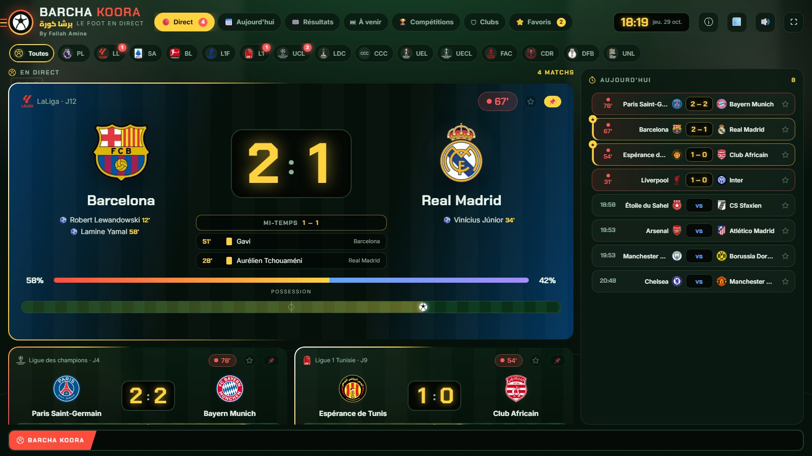
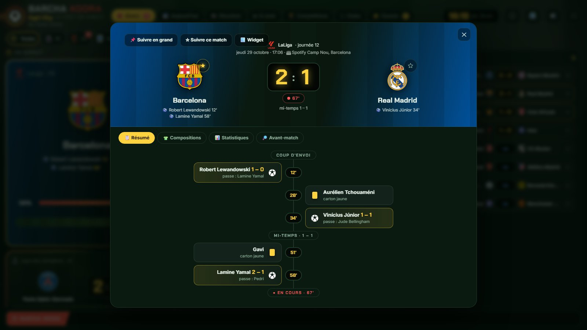
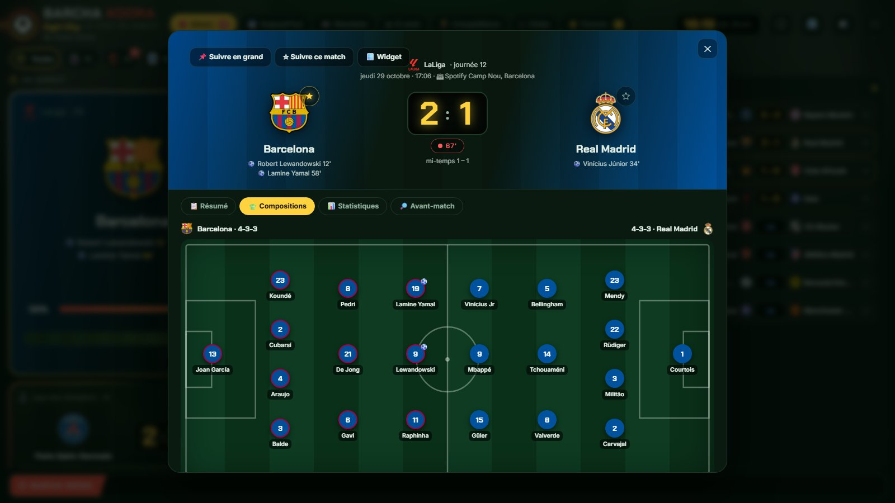
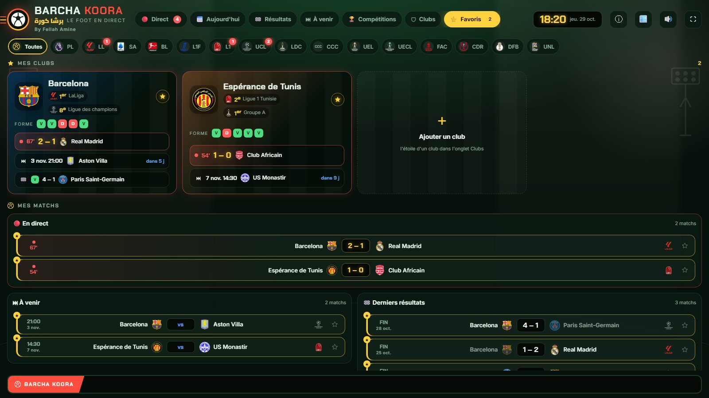
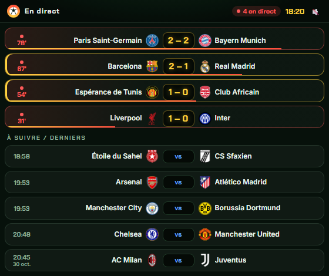

  

<h1 align="center">Barcha Koora · برشا كورة</h1>

<b>Le foot en direct, sur ton PC et ton téléphone.</b> 
Scores à la minute, alerte à chaque but, compos, stats et classements, pour Windows et Android.

  <a href="https://github.com/fellahamin/barcha-koora/releases/latest/download/BarchaKooraSetup.exe"><b>⬇ Windows</b></a>
  &nbsp;·&nbsp;
  <a href="https://github.com/fellahamin/barcha-koora/releases/latest/download/BarchaKoora.apk"><b>📱 Android</b></a>
  &nbsp;·&nbsp;
  <a href="https://fellahamin.github.io/barcha-koora/">🌐 Le site</a>
  &nbsp;·&nbsp;
  <a href="https://ba9chich.com/BouBatman">☕ Soutenir sur Ba9chich</a>

> Captures faites avec des matchs de démonstration.

## Ce que fait l'application

- ⏱️ **La vraie minute** : scores et minute du match en direct, mis à jour toutes les 60 secondes.
- 🔔 **Alerte à chaque but** : une notification et un son pour tes clubs et les matchs que tu suis, plus un rappel 30 minutes avant le coup d'envoi.
- 🪟 **Widgets flottants** (Windows) : un match, ou toute la soirée, dans un coin de l'écran, par-dessus tes fenêtres.
- 📋 **Compos et stats** : les onze titulaires sur le terrain, les buts, les cartons, la possession, les tirs, les xG.
- 🏆 **Classements** de chaque championnat, avec la forme des cinq derniers matchs.
- ⭐ **Mes clubs** : une étoile sur ton club, et son match en cours, son prochain match, ses résultats et sa place sont réunis sur une page.
- 📺 **Suivre en grand** (Windows) : le match en plein écran, pour la télé du salon ou du café.
- 🔄 **Toujours à jour** : nouvelles équipes, logos et résultats de la saison arrivent tout seuls.

29 compétitions, dont la **Ligue 1 tunisienne**, la Coupe de Tunisie, la Ligue des champions (UEFA et CAF), la Coupe de la Confédération CAF, la CAN, la Coupe du monde, la Premier League, LaLiga, la Serie A, la Bundesliga et la Ligue 1.

| Le résumé du match | Les compositions |
|---|---|
|  |  |
| **Mes clubs** | **Le widget** |
|  |  |

## Installer sur Windows, en 3 étapes

1. **Télécharge** [BarchaKooraSetup.exe](https://github.com/fellahamin/barcha-koora/releases/latest/download/BarchaKooraSetup.exe) (environ 30 Mo). Toutes les versions sont dans [Releases](https://github.com/fellahamin/barcha-koora/releases).
2. **Lance-le.** Si Windows affiche « Windows a protégé votre ordinateur », clique sur **Informations complémentaires**, puis sur **Exécuter quand même**. Ce message apparaît parce que l'installateur n'a pas de signature payante (c'est un projet indépendant), pas parce qu'il y a un problème.
3. **Coup d'envoi !** L'installateur prépare tout, y compris les premiers matchs (1 à 3 minutes). Barcha Koora s'ouvre ensuite, et une icône ballon reste près de l'horloge de Windows pour les alertes.

Pas besoin d'être administrateur ni de créer un compte. L'application s'installe dans ton dossier utilisateur (`%LOCALAPPDATA%\Programs\Barcha Koora`).

**Il faut** : Windows 10 ou 11 (64 bits), Microsoft Edge (déjà présent dans Windows) et une connexion Internet.

## Installer sur Android

L'application Android (0.2.0, **version bêta**) fonctionne seule, sans le PC : scores en direct, matchs jour par jour, compétitions et classements, pages de clubs (forme, matchs, résultats, effectif), favoris.

1. **Télécharge** [BarchaKoora.apk](https://github.com/fellahamin/barcha-koora/releases/latest/download/BarchaKoora.apk) (environ 18 Mo) depuis ton téléphone.
2. **Ouvre le fichier.** Android demande d'autoriser l'installation depuis ton navigateur ou tes fichiers : autorise-la. L'application n'est pas sur le Play Store, Play Protect peut donc afficher un avertissement : choisis **Installer quand même**.
3. **Pour les alertes de but, application fermée** : mets une étoile sur tes clubs, touche **ⓘ** en haut, puis autorise les notifications, la **batterie sans restriction** et le réveil à l'heure du match. Pendant un match suivi, une notification « Match en cours » reste affichée, puis disparaît à la fin.

**Il faut** : Android 6 ou plus récent et une connexion Internet (environ 3 Mo par heure de direct, l'écran allumé).

## Utilisation

### Sur Windows

- Clique sur l'**étoile** d'un club (onglet Clubs) pour recevoir ses alertes et le retrouver dans Favoris.
- Clique sur un match pour voir son résumé, les compositions et les statistiques. **Suivre ce match** active ses alertes ; **Widget** le garde à l'écran.
- L'icône **ballon**, près de l'horloge, rouvre l'application, ouvre les widgets et règle « Lancer avec Windows ». Fermer la fenêtre ne coupe pas les alertes : pour tout arrêter, clic droit sur le ballon → Quitter.

### Sur Android

- Touche un match pour son résumé, ses compositions et ses statistiques, un club pour sa page, une compétition pour son classement.
- ⭐ sur un club : il arrive dans Favoris, avec ses alertes. 🔔 sur un match : tu suis ce match seul.

## Mettre à jour

Les matchs, scores et classements se mettent à jour tout seuls, en continu. Pour une nouvelle version :

- **Windows** : télécharge le dernier installateur et lance-le. Il détecte la version installée et la remplace en gardant tes clubs, tes matchs suivis et tes réglages.
- **Android** : télécharge le dernier APK et installe-le par-dessus. Tes clubs et tes réglages restent.

## Désinstaller

- **Windows** : Paramètres → Applications → Applications installées → **Barcha Koora** → Désinstaller.
- **Android** : appui long sur l'icône → Désinstaller.

## Questions

**D'où viennent les scores ?** De sources publiques de résultats en direct, lues par l'application elle-même, sur ton PC ou ton téléphone. Il n'y a pas de serveur Barcha Koora entre toi et le match, et aucune donnée personnelle n'est envoyée.

**Mac, Linux, iPhone ?** Pas pour l'instant : Windows 10 et 11 en 64 bits, et Android.

**Les alertes arrivent en retard sur Android ?** Vérifie les réglages dans ⓘ. Certaines marques (Samsung, Xiaomi, Huawei) limitent aussi les applications en arrière-plan : autorise Barcha Koora dans leurs réglages de batterie, et signale ton modèle dans une issue.

**Un souci, un club qui manque ?** Ouvre une [issue](https://github.com/fellahamin/barcha-koora/issues) en expliquant ce que tu vois (et ta version, dans ⓘ À propos).

## Soutenir

Barcha Koora est gratuit et sans pub. Si l'application te sert, un petit geste sur [Ba9chich](https://ba9chich.com/BouBatman) aide à la garder à jour.

---

By [Fellah Amine](https://github.com/fellahamin). Ce dépôt sert à distribuer l'installateur Windows et l'application Android ; le code n'y est pas.
Barcha Koora n'est lié à aucun club, ligue ou fédération. Les noms et logos appartiennent à leurs propriétaires.
