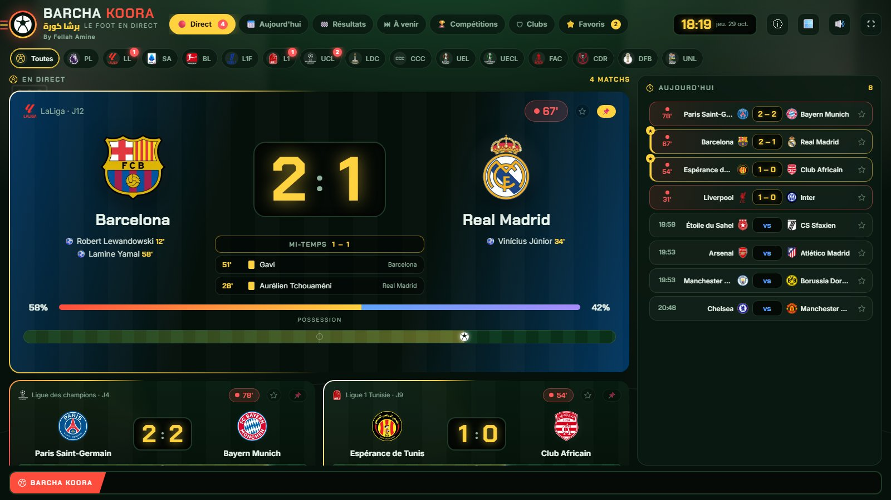
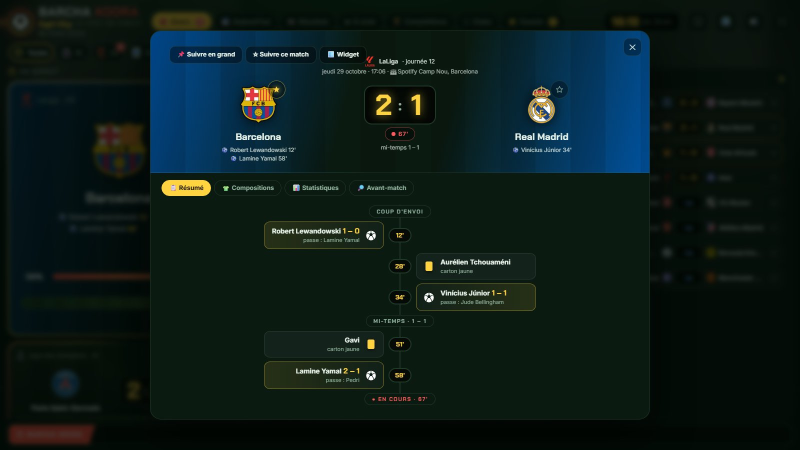
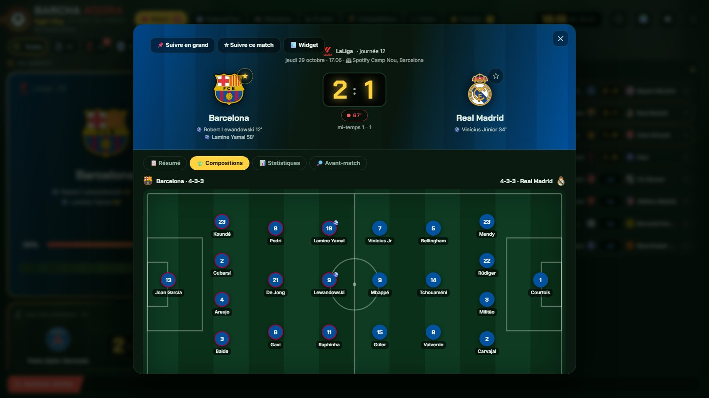
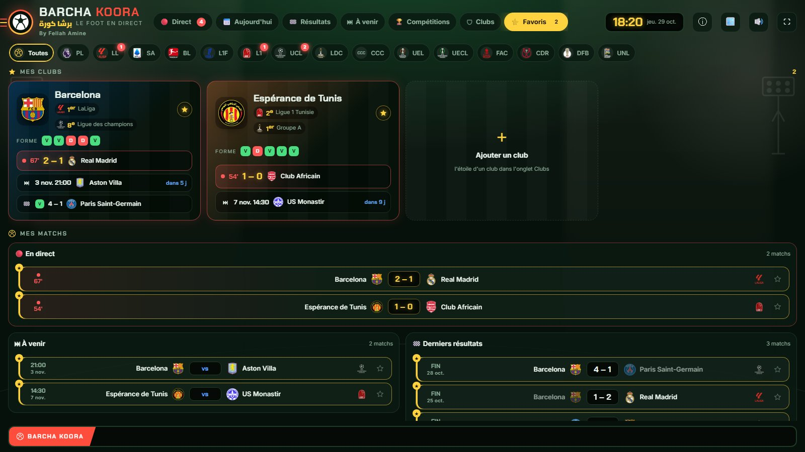
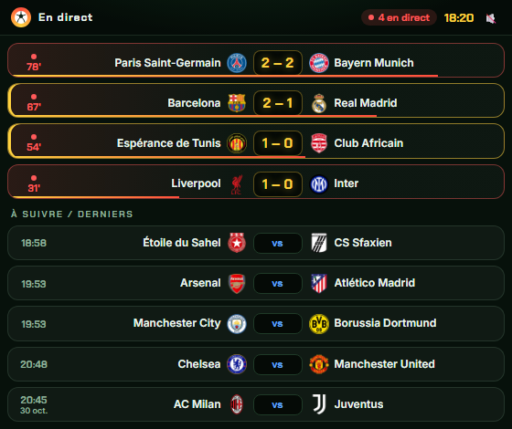

  

<h1 align="center">Barcha Koora · برشا كورة</h1>

<b>Le foot en direct, sur ton PC.</b> 
Scores à la minute, alerte à chaque but, compos, stats, classements et widgets, pour Windows.

  <a href="https://github.com/fellahamin/barcha-koora/releases/latest/download/BarchaKooraSetup.exe"><b>⬇ Télécharger pour Windows</b></a>
  &nbsp;·&nbsp;
  <a href="https://ba9chich.com/BouBatman">☕ Soutenir sur Ba9chich</a>

> Captures faites avec des matchs de démonstration.

## Ce que fait l'application

- ⏱️ **La vraie minute** : scores et minute du match en direct, mis à jour toutes les 60 secondes.
- 🔔 **Alerte à chaque but** : une notification Windows et un son pour tes clubs et les matchs que tu suis, plus un rappel 30 minutes avant le coup d'envoi.
- 🪟 **Widgets flottants** : un match, ou toute la soirée, dans un coin de l'écran, par-dessus tes fenêtres.
- 📋 **Compos et stats** : les onze titulaires sur le terrain, les buts, les cartons, la possession, les tirs, les xG.
- 🏆 **Classements** de chaque championnat, avec la forme des cinq derniers matchs.
- ⭐ **Mes clubs** : une étoile sur ton club, et son match en cours, son prochain match, ses résultats et sa place sont réunis sur une page.
- 📺 **Suivre en grand** : le match en plein écran, pour la télé du salon ou du café.
- 🔄 **Toujours à jour** : nouvelles équipes, logos et résultats de la saison arrivent tout seuls.

29 compétitions, dont la **Ligue 1 tunisienne**, la Coupe de Tunisie, la Ligue des champions (UEFA et CAF), la Coupe de la Confédération CAF, la CAN, la Coupe du monde, la Premier League, LaLiga, la Serie A, la Bundesliga et la Ligue 1.

| Le résumé du match | Les compositions |
|---|---|
|  |  |
| **Mes clubs** | **Le widget** |
|  |  |

## Installer en 3 étapes

1. **Télécharge** [BarchaKooraSetup.exe](https://github.com/fellahamin/barcha-koora/releases/latest/download/BarchaKooraSetup.exe) (environ 30 Mo). Toutes les versions sont dans [Releases](https://github.com/fellahamin/barcha-koora/releases).
2. **Lance-le.** Si Windows affiche « Windows a protégé votre ordinateur », clique sur **Informations complémentaires**, puis sur **Exécuter quand même**. Ce message apparaît parce que l'installateur n'a pas de signature payante (c'est un projet indépendant), pas parce qu'il y a un problème.
3. **Coup d'envoi !** L'installateur prépare tout, y compris les premiers matchs (1 à 3 minutes). Barcha Koora s'ouvre ensuite, et une icône ballon reste près de l'horloge de Windows pour les alertes.

Pas besoin d'être administrateur ni de créer un compte. L'application s'installe dans ton dossier utilisateur (`%LOCALAPPDATA%\Programs\Barcha Koora`).

**Il faut** : Windows 10 ou 11 (64 bits), Microsoft Edge (déjà présent dans Windows) et une connexion Internet.

## Utilisation

- Clique sur l'**étoile** d'un club (onglet Clubs) pour recevoir ses alertes et le retrouver dans Favoris.
- Clique sur un match pour voir son résumé, les compositions et les statistiques. **Suivre ce match** active ses alertes ; **Widget** le garde à l'écran.
- L'icône **ballon**, près de l'horloge, rouvre l'application, ouvre les widgets et règle « Lancer avec Windows ». Fermer la fenêtre ne coupe pas les alertes : pour tout arrêter, clic droit sur le ballon → Quitter.

## Mettre à jour

Les matchs, scores et classements se mettent à jour tout seuls, en continu. Pour une nouvelle version de l'application, télécharge le dernier installateur et lance-le : il détecte la version installée et la remplace en gardant tes clubs, tes matchs suivis et tes réglages.

## Désinstaller

Paramètres Windows → Applications → Applications installées → **Barcha Koora** → Désinstaller.

## Questions

**D'où viennent les scores ?** De sources publiques de résultats en direct, lues par l'application elle-même, sur ton PC. Il n'y a pas de serveur Barcha Koora entre toi et le match, et aucune donnée personnelle n'est envoyée.

**Mac, Linux, téléphone ?** Pas pour l'instant : Windows 10 et 11 en 64 bits seulement.

**Un souci, un club qui manque ?** Ouvre une [issue](https://github.com/fellahamin/barcha-koora/issues) en expliquant ce que tu vois (et ta version, dans ⓘ À propos).

## Soutenir

Barcha Koora est gratuit et sans pub. Si l'application te sert, un petit geste sur [Ba9chich](https://ba9chich.com/BouBatman) aide à la garder à jour.

---

By [Fellah Amine](https://github.com/fellahamin). Ce dépôt sert à distribuer l'installateur ; le code de l'application n'y est pas.
Barcha Koora n'est lié à aucun club, ligue ou fédération. Les noms et logos appartiennent à leurs propriétaires.
